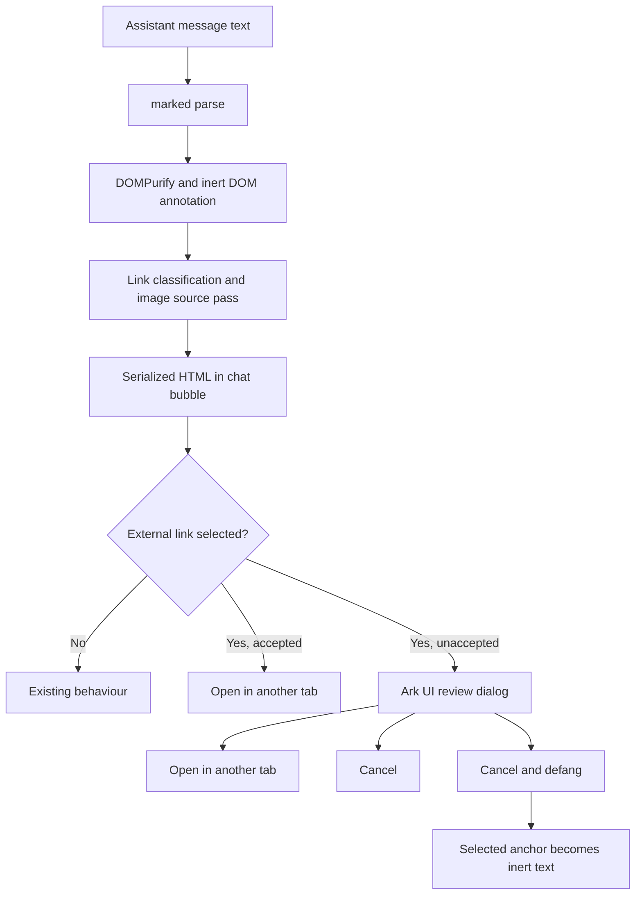

# Link verification prompt for chat messages

Design for [#901](https://github.com/mknw/hames-playground/issues/901). This is for owner review before implementation. The owner ruled on 2026-10-31 that a message with external links shows a small **Links unverified** indicator and an **Accept as safe** action. Selecting a link that has not been accepted opens a HITL-style dialog with (a) why it is not recognised, (b) its whole address, and (c) **Open in another tab**, **Cancel**, and **Cancel and defang**. The last choice makes the selected link no longer a link. No application behaviour changes in this PR.

## Source baseline

The file and line references below were read on `origin/main` at `f48dd6b9046e95442f30a97190101a6c328d7251` (2026-10-31).

| Current path                                                                                                                                                                                                                                                                                        | Verified source                                                                                                                                                             |
| --------------------------------------------------------------------------------------------------------------------------------------------------------------------------------------------------------------------------------------------------------------------------------------------------- | --------------------------------------------------------------------------------------------------------------------------------------------------------------------------- |
| Assistant markdown is parsed by `marked`, then passed to `sanitizeMarkdownHtml`; its result is assigned to `innerHTML` in each assistant bubble. The same `ChatMessages` renderer is used in the live chat and shared transcript.                                                                   | `app/src/components/ark-ui/ChatMessages.tsx:267-275,358-360,467-484`; `app/src/components/ark-ui/ChatInterface.tsx:580`; `app/src/routes/s/[token].tsx:141`                 |
| The sanitizer retains `a` and `href`, strips unapproved markup and attributes, and stamps rendered anchors with `target="_blank"` and `rel="noopener noreferrer"`. The `noreferrer` part also protects the shared transcript's token in its page URL.                                               | `app/src/lib/sanitize-html.ts:26-58,88-98,124-145,314-338`; `app/src/routes/s/[token].tsx:21-30`                                                                            |
| The only allowed image sources are bounded data rasters and the scoped Data Stash download route. Every other image becomes inert placeholder text **before** the HTML reaches the live document; other elements' `src` is removed.                                                                 | `app/src/lib/sanitize-html.ts:175-237,239-275,314-338`                                                                                                                      |
| The current `exfil-data-url` rule belongs to the tool-result injection guard, has a `defang` action, and is enabled in the built-in corpus unless the declaring guard disables it. `disableRules` is the existing per-guard switch; there is no dedicated app switch in the declarations read here. | `packages/harness-patterns/injection-guard.ts:700-711,1134-1146`; `packages/harness-patterns/patterns/withInjectionGuard.server.ts:172-182`                                 |
| The guard rewrites a tool result before the caller receives it and before the model screen reads a result with a deterministic finding. Thus today's data-URL defanging can change what the model sees.                                                                                             | `packages/harness-patterns/patterns/withInjectionGuard.server.ts:260-281,350-374`; `packages/harness-patterns/mcp-client.server.ts:399-426`                                 |
| The existing `HitlDialog` contains an Ark `Dialog` shell with safe initial focus, a warning, a scrollable body, and actions. `BlockingRequestPrompt` controls one of its current bodies. The shared shell's prop union currently accepts only memory and blocking requests.                         | `app/src/components/ark-ui/HitlDialog.tsx:1-26,80-90,97-125,147-223`; `app/src/components/ark-ui/BlockingRequestPrompt.tsx:1-20,43-50`                                      |
| `GRAPH_DOCUMENT_HOSTS` is validated as exact bare hostnames on the server and currently narrows one Graph result field's data-URL guard treatment; it does not define general chat-link trust today.                                                                                                | `app/src/lib/harness-client/document-hosts.server.ts:1-12,15-38`; `packages/agents/agents/general-next.server.ts:208`; `packages/agents/agents/microsoft-365.server.ts:128` |

## Proposed interaction and placement

The proposed classification runs on the sanitized **inert DOM** in `sanitizeMarkdownHtml` or its existing annotation pass, before serialization and `innerHTML`. The renderer can then count links per message for the indicator and attach only code-owned metadata needed for click handling. Keep the sanitizer's output as the final HTML string: the existing source explicitly prohibits post-serialization string edits (`app/src/lib/sanitize-html.ts:292-305,314-338`). The same component path must handle newly streamed messages, restored history, and the shared transcript (`app/src/components/ark-ui/ChatMessages.tsx:267-275,373-375,467-484`; `app/src/routes/s/[token].tsx:141`).

The indicator sits in the assistant message bubble beside its rendered content. **Accept as safe** changes the selected scope's state only after an explicit action; until then, an unrecognised external anchor's ordinary click and keyboard activation are intercepted before navigation. The dialog renders the reason and complete address as text, without ellipsis or executable markup. The **Open in another tab** action is an actual anchor activated by the person's click, with `target="_blank"` and `rel="noopener noreferrer"`; **Cancel** closes without navigation; **Cancel and defang** replaces the chosen anchor with non-interactive text in that message. Escape and backdrop close with the same outcome as Cancel, and focus starts on Cancel, following the existing shell (`app/src/components/ark-ui/HitlDialog.tsx:14-26,119-125`). Keep the indicator and dialog text explicit rather than relying on colour alone. Use Ark UI `Dialog` and the repo's UnoCSS attributify styling; reuse `HitlDialog`'s shell if it can take a link-review body without coupling a navigation choice to the server-side HITL answer flow (`app/src/components/ark-ui/HitlDialog.tsx:80-113,115-223`; `app/src/components/ark-ui/BlockingRequestPrompt.tsx:13-20`). This is a UI review pattern, not a paused agent run.

The explanation must state the classification fact, such as “This address is not on the recognised host list,” rather than asserting that the destination is unsafe. The whole resolved address must be visible and selectable in the dialog, including its path and query, with wrapping or scrolling at narrow widths. The final implementation must preserve the sanitizer's scheme filtering and the image source pass; no link approval may turn an external image into an automatically loaded `` (`app/src/lib/sanitize-html.ts:218-275,314-338`).

## Staging the existing rule

The owner has put [PR #888](https://github.com/mknw/hames-playground/pull/888) on hold. This design does not change it. The existing `exfil-data-url` rule remains available: the implementation first lands the click gate and the no-click resource policy, then flips that rule's **default to off** in the same release. It must retain an explicit way to turn the rule back on. Today's switch is `disableRules`, which can turn an on-by-default corpus rule off but cannot by itself turn an off-by-default rule on; implementation therefore needs a clear opt-in representation while preserving the existing per-guard switch contract (`packages/harness-patterns/injection-guard.ts:700-711,1134-1146`; `packages/harness-patterns/patterns/withInjectionGuard.server.ts:172-182`). The `exfil-auto-image` and `exfil-html-tag` rules are separate corpus entries and are not part of that default flip (`packages/harness-patterns/injection-guard.ts:681-710`).

With the data-URL rule off by default, the model sees live links in tool results where that rule formerly rewrote them; the renderer's prompt acts only when a person selects a link. Agent-side fetches remain governed by the separate per-tool egress design in [PR #894](https://github.com/mknw/hames-playground/pull/894), not by this UI prompt. This statement does not claim that a link is safe for the model or that the UI controls agent tool calls (`packages/harness-patterns/patterns/withInjectionGuard.server.ts:260-281,350-374`; `packages/harness-patterns/mcp-client.server.ts:399-426`).

## Questions for the owner — recommendations, not decisions

1. **What is “recognised”?** Recommendation: evaluate exact hosts from the configured `GRAPH_DOCUMENT_HOSTS` list and the app's own origin; do not infer recognition from a familiar-looking substring. A mail or shared-item link whose parsed host is recognised would need no prompt. Board item N20 (mail and shared-item links being neutralised) should then close into this design rather than stay a separate UI rule. The current host list is server-only and field-specific, so implementation must provide a validated classification result to the browser without making the client import server code (`app/src/lib/harness-client/document-hosts.server.ts:1-12,19-38`; `packages/agents/agents/general-next.server.ts:208`). **Owner decision:** approve this recognised set and N20 disposition, or name another criterion.
2. **What does “Accept as safe” cover and how long does it last?** Recommendation: all the exact external links currently in that message, for the current browser session; repeat links in other messages still ask. This matches the message-level action without extending acceptance to a whole host. Keep the indicator visible and change its text to “Links accepted” when that message's links are accepted. If persistence is wanted, choose its owner and store deliberately; the shared transcript also uses `ChatMessages` (`app/src/routes/s/[token].tsx:141`). **Owner decision:** per link, per message, or per host; session only or stored, and where; whether defanging has the same lifetime.
3. **What about resources that load without a click?** Recommendation: never auto-load an external markdown image. Keep the current inert placeholder, but make it an explicit review trigger if the owner wants an “Open image in another tab” path. Do not generate link previews or fetch link targets during render; any future preview needs its own explicit gate before the request. A click gate alone cannot cover these requests, and the current image pass exists precisely before `innerHTML` (`app/src/lib/sanitize-html.ts:148-173,239-275,314-338`). **Owner decision:** confirm this no-auto-load policy and whether image placeholders offer the dialog's open action.
4. **What does the model see?** Recommendation: make the changed exposure explicit in the release plan and keep agent-side fetching under PR #894's per-tool egress design. Today the tool-result rule can defang before the model reads the result; after its default flips off, the model sees live links. A browser click approval does not grant the agent permission to fetch them (`packages/harness-patterns/patterns/withInjectionGuard.server.ts:260-281,350-374`; `packages/harness-patterns/mcp-client.server.ts:399-426`). **Owner decision:** confirm this trade-off before the default flip.
5. **What happens to #888?** Recommendation: close it as superseded after the owner accepts this design; keep it on hold meanwhile. Reusing its matcher as the dialog's “why not recognised” classifier would conflate link shape with host recognition. **Owner decision:** close as superseded, or keep its matcher for that classifier.

## Review boundary

The owner resolves the questions above before any implementation. This PR contains only this design document; it changes no application code, test, guard default, or PR #888 state.
