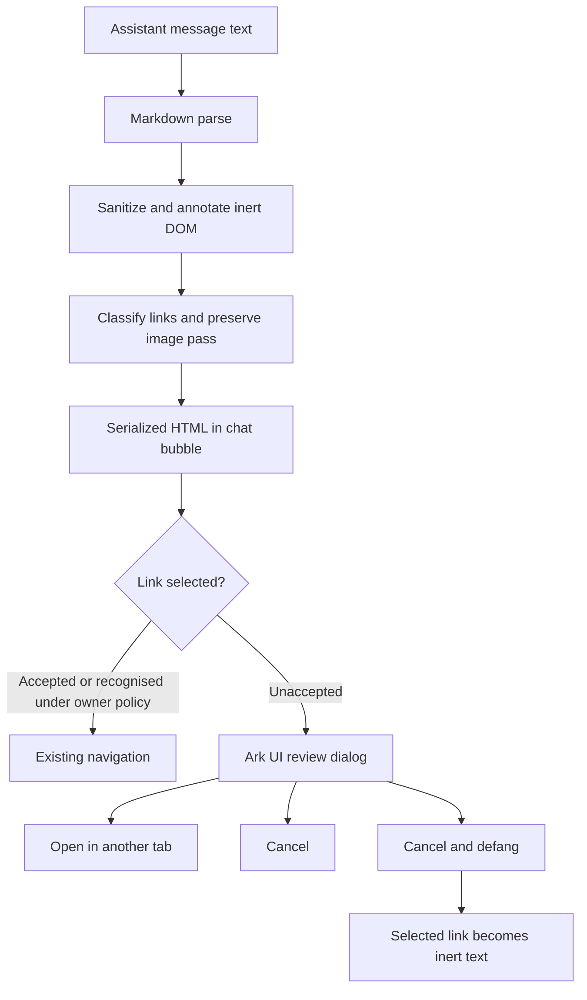

# Link verification prompt for chat messages

Design for [#901](https://github.com/mknw/hames-playground/issues/901). This is for owner review before implementation. A message containing external links shows a small **Links unverified** indicator and an **Accept as safe** action. Selecting a link that has not been accepted opens a HITL-style dialog with (a) why the link is not recognised, (b) its whole address, and (c) **Open in another tab**, **Cancel**, and **Cancel and defang**. The last choice makes the selected link no longer a link. This PR changes no application behaviour.

## Source baseline

The file and line references below were read on `origin/main` at `f48dd6b9046e95442f30a97190101a6c328d7251`.

| Current path                                                                                                                                                                                                                          | Verified source                                                                                                                                                             |
| ------------------------------------------------------------------------------------------------------------------------------------------------------------------------------------------------------------------------------------- | --------------------------------------------------------------------------------------------------------------------------------------------------------------------------- |
| Assistant markdown passes through `marked` and `sanitizeMarkdownHtml` before reaching `innerHTML`. The same `ChatMessages` renderer serves live chat and shared transcripts.                                                          | `app/src/components/ark-ui/ChatMessages.tsx:267-275,358-360,467-484`; `app/src/components/ark-ui/ChatInterface.tsx:580`; `app/src/routes/s/[token].tsx:141`                 |
| The sanitizer keeps anchors and `href`, applies DOMPurify's URI policy, and stamps rendered links with `target="_blank"` and `rel="noopener noreferrer"`. The `noreferrer` part protects the shared transcript token in its page URL. | `app/src/lib/sanitize-html.ts:26-58,88-98,124-145,314-338`; `app/src/routes/s/[token].tsx:21-30`                                                                            |
| The existing image pass allows bounded data rasters and the scoped Data Stash download route. Every other image becomes inert text before HTML reaches the live document; other elements' `src` is removed.                           | `app/src/lib/sanitize-html.ts:175-237,239-275,314-338`                                                                                                                      |
| The existing `HitlDialog` provides an Ark `Dialog` shell with safe initial focus, a warning, scrollable body and actions. It currently dispatches between two bodies; `BlockingRequestPrompt` controls one of them.                   | `app/src/components/ark-ui/HitlDialog.tsx:1-26,80-90,97-125,147-223`; `app/src/components/ark-ui/BlockingRequestPrompt.tsx:1-20,43-50`                                      |
| `GRAPH_DOCUMENT_HOSTS` is a validated, server-side list of exact hostnames. Its current use is limited to a connector-owned result field; it is not a general chat-link trust policy.                                                 | `app/src/lib/harness-client/document-hosts.server.ts:1-12,15-38`; `packages/agents/agents/general-next.server.ts:208`; `packages/agents/agents/microsoft-365.server.ts:128` |

## Proposed interaction and placement

Classify the sanitized **inert DOM** in `sanitizeMarkdownHtml` or its annotation pass, before serialization and `innerHTML`. Count links per message for the indicator, and attach only code-owned metadata for the interaction. Do not rewrite the returned HTML string: the sanitizer's source explicitly prohibits transformations after serialization (`app/src/lib/sanitize-html.ts:292-305,314-338`). The path must cover streaming, restored history and shared transcripts through the same renderer (`app/src/components/ark-ui/ChatMessages.tsx:267-275,373-375,467-484`; `app/src/routes/s/[token].tsx:141`).

Place the indicator beside the assistant message's rendered content. The dialog presents a factual reason, such as “This address is not on the recognised host list,” without calling the destination unsafe. Show the complete resolved address, including path and query, as selectable **body text** that wraps or scrolls. Keep `Dialog.Description` to a short summary so opening the dialog does not read the whole address aloud; this follows the existing shell's description rule (`app/src/components/ark-ui/HitlDialog.tsx:14-26,147-153,200-212`). Give the indicator and its action explicit accessible names, and announce a changed acceptance state through a polite live region. Focus Cancel on open. Escape and backdrop close with the same outcome as Cancel (`app/src/components/ark-ui/HitlDialog.tsx:14-26,119-125`).

Extend the existing `HitlDialog` union with a third, client-only link-review body that reuses its `DialogShell`; do not bind navigation to the server-side HITL answer or resume flow (`app/src/components/ark-ui/HitlDialog.tsx:80-115,119-223`; `app/src/components/ark-ui/BlockingRequestPrompt.tsx:13-20`). Style it with UnoCSS attributify. **Open in another tab** is an anchor activated by the person's click, with `target="_blank"` and `rel="noopener noreferrer"`. **Cancel** closes without navigation. **Cancel and defang** makes only the chosen link non-interactive text in this message. Preserve the sanitizer's URI policy and existing image source pass: accepting a link never makes an external image auto-load (`app/src/lib/sanitize-html.ts:218-275,314-338`).

An anchor's primary click and keyboard activation can be intercepted, and `auxclick` can be handled where the platform permits. Modifier clicks, context-menu opening, and dragging a live anchor may bypass a click handler. The owner must choose whether those paths are an accepted limitation; until then, the indicator and dialog copy must not promise that every form of navigation is intercepted. The reviewed **Open in another tab** action remains the intended path. The browser gate reviews navigation by a person; it does not provide equivalent protection for model-visible content or inspect every property of an address.

## Rollout boundary

Preserve the current no-click image policy; it already runs before chat HTML becomes live (`app/src/lib/sanitize-html.ts:258-275,314-338`). Ship and confirm the browser interaction in one release. Treat any upstream default change as a separate release, contingent on evidence that the gate is active for clients in use. A same-release server change cannot assume an already-open chat tab or cached bundle has acquired new client code. The existing upstream rule and its switch remain available; no guard default changes in this PR. The existing rule-extension hook provides a structural opt-in, so a later implementation need not invent a second configuration surface (`packages/harness-patterns/SPEC.md:983-991`). Re-evaluate the existing source-field exemption when that default is revisited: it could otherwise become dormant, or drift from the UI's recognised-host policy if re-enabled (`app/src/lib/harness-client/document-hosts.server.ts:1-12`; `packages/harness-patterns/SPEC.md:989-991`). [PR #888](https://github.com/mknw/hames-playground/pull/888) remains on hold.

## Questions for the owner — recommendations, not decisions

1. **What is “recognised”?** Recommendation: use exact hosts from `GRAPH_DOCUMENT_HOSTS` and the app's own origin as candidate hosts, and decide explicitly whether a link's provenance can grant a no-prompt path. This would extend a list now used for one connector-owned field to links that may come from message bodies; a recognised host alone says nothing about who authored the link or about the rest of its address (`app/src/lib/harness-client/document-hosts.server.ts:1-12,19-38`). If the owner accepts host recognition for mail and shared-item content, a link from a recognised host needs no prompt. Board item N20 should then close into this design; otherwise keep N20 open. **Owner decision:** approve the recognised set and its treatment of message-body links, or name another criterion, then decide N20's disposition.
2. **What does “Accept as safe” cover and how long does it last?** Recommendation: accept one exact, resolved link in one message for the browser session. The message-level action can present that message's unverified links for explicit selection; accepting one must not silently accept another. Keep the indicator visible and announce its state when all links are accepted. A client-side defang changes only the current rendering: `ChatMessages` derives HTML again from `message.content`, and the shared transcript renders it separately (`app/src/components/ark-ui/ChatMessages.tsx:358-360,467-484`; `app/src/routes/s/[token].tsx:141`). Persistence across reloads or viewers requires a deliberate server-side record. **Owner decision:** per link, per message or per host; browser session only or stored, and where; whether defanging has the same lifetime.
3. **What about resources that load without a click?** Recommendation: keep external markdown images inert and show a placeholder; optionally let that placeholder open the same review dialog for an explicit **Open in another tab** action. Do not generate link previews or fetch link targets during render. A click handler cannot govern auto-loads, and the current image pass already prevents external image loading before `innerHTML` (`app/src/lib/sanitize-html.ts:148-173,239-275,314-338`; `app/src/lib/security-headers.ts:52-63`). **Owner decision:** confirm this no-auto-load policy and whether image placeholders offer the dialog action.
4. **What does the model see?** Recommendation: review model-visible link handling as a separate rollout decision. The chat dialog runs after model output and cannot change what the model read or what an agent may fetch. Agent-side fetches stay under the per-tool egress design in [PR #894](https://github.com/mknw/hames-playground/pull/894); browser acceptance grants the agent no fetch permission. **Owner decision:** confirm the separate model-visible policy before an upstream default changes.
5. **What happens to #888?** Recommendation: close it as superseded after the owner accepts this design; keep it on hold meanwhile. Its matcher is not a host-recognition test, but its logic may be evaluated as a separate address-property reason in the dialog. **Owner decision:** close as superseded, or retain its matcher for an auxiliary explanation.
6. **How is the rollout staged?** Recommendation: use two releases and confirm client coverage before any upstream default adjustment. **Owner decision:** set the coverage evidence and readiness threshold, or explicitly accept the residual window in older tabs.
7. **Does the dialog assess address properties beyond the host?** Recommendation: show a second, independent caution when an address contains properties that need review, even if its host is recognised. Host recognition alone cannot make the browser prompt equivalent to upstream content handling. **Owner decision:** approve that extra reason and its source, or accept the narrower protection.
8. **Which activation routes must trigger review?** Recommendation: intercept primary, keyboard and auxiliary activation where supported, state the remaining context-menu and drag limitation plainly, and avoid absolute copy. **Owner decision:** accept that limitation or require a different link presentation that prevents navigation before review.
9. **Which URI schemes count as external links?** Recommendation: apply the indicator and tab-opening dialog only to `http:` and `https:` anchors. Keep other schemes under the sanitizer's existing URI policy and specify their behavior separately; they cannot truthfully be explained by a host-list reason or promised a browser tab (`app/src/lib/sanitize-html.ts:314-338`). **Owner decision:** exclude other schemes from this indicator, or define their own prompt and action copy.
10. **What happens to the source-field exemption?** Recommendation: keep its behavior paired with the upstream rule when explicitly enabled, and check it against the UI's recognised-host policy; do not silently convert its narrow scope into general trust (`app/src/lib/harness-client/document-hosts.server.ts:1-12`; `packages/harness-patterns/SPEC.md:989-991`). **Owner decision:** retain and align it, or retire it deliberately when the later policy is approved.

## Review boundary

The owner resolves these questions before implementation. This PR contains only this design document; it changes no application code, tests, guard defaults or PR #888 state.
